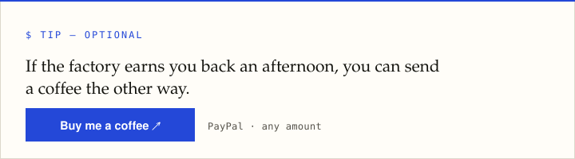

# let-me-code

An **agent factory** for [opencode](https://opencode.ai): a roster of
specialised subagents (architect, senior-dev, qa-engineer, git-agent,
tech-writer, …), a library of workflow skills, and a delegation MCP server
that orchestrates them. Bootstrap it into any project with one command.

It fits teams that want AI coding agents with actual separation of duties —
planning, implementation, review, and commit are different agents with
different permissions — instead of one chatbot doing all of it.

**[Documentation site](https://walidmoustafa2077.github.io/let-me-code/)** ·
[Source on GitHub](https://github.com/walidmoustafa2077/let-me-code) ·
MIT · Node.js 22.18+

<p align="center">
  <a href="https://paypal.me/walidmoustafa2077">
    <picture>
      <source media="(prefers-color-scheme: dark)" srcset="https://raw.githubusercontent.com/walidmoustafa2077/let-me-code/main/.github/assets/support-card-dark.svg">
      
    </picture>
  </a>
</p>

## Quick start

```bash
# inside the project you want to run the factory in
npx github:walidmoustafa2077/let-me-code
```

The CLI copies the factory assets, merges `opencode.json`, installs the MCP
dependencies, and (optionally) initialises git. The installed command is
`let-me-code`; run it again to upgrade. Then:

```bash
opencode serve --port 4096   # in one terminal
opencode                     # in another; talk to the Orchestrator
```

On opencode v2 the server requires Basic auth: export `OPENCODE_SERVER_PASSWORD` before starting
both sides (the username is `opencode`, or whatever you set in `OPENCODE_SERVER_USERNAME`). The
delegation client detects v1 or v2 on its own and speaks whichever API the server exposes; when it
has to start the server itself it generates a password and hands it to the child process.

## What it installs

| Path | Purpose |
| --- | --- |
| `.opencode/agent/*` | The subagent roster |
| `.opencode/skills/*` | The skill library — 85 skills, see `skills-inventory/SKILLS.md` |
| `mcp/delegation/` | The delegation MCP server (TypeScript, run directly by Node) |
| `opencode.json` | MCP + agent wiring (merged into yours, never clobbered) |
| `DELEGATE_CONFIG.json` | Engine, server URL, timeouts, allowed agents |

## How a run goes

The orchestrator is the only agent you talk to, and it stops for you twice before any code exists.

```
ROUTE → INTERVIEW → INTENT → SPEC → [SPEC GATE: you approve] → TICKETS → [BUILD GATE: you approve]
      → POPULATE → EXECUTE → QUALITY → LAND → CLOSE
```

- **Interview** — one question per turn, until problem, scope, stack, data, privacy, interface,
  look and done-criteria are all answered. There is no upper limit on questions.
- **Two gates** — the spec and the ticket list are both shown to you, and nothing is built,
  committed, or dispatched until you say yes. Silence is not approval.
- **Skills are not optional** — every agent opens by loading the skill that governs its job and
  reports the list in the `skills:` line of its handoff. An agent that reports none is
  re-dispatched instead of trusted.
- **No silent waits** — a child that produces nothing for `timeouts.stallMs` (3 minutes) is
  aborted, logged, and retried once in a fresh session. A second stall blocks the ticket and
  tells you what was tried.

Scaffolding copies `.opencode` as-is, so a new project receives all 85 skills (~37 MB, of which
33 MB is the `taste-skill/assets/` photography and scene library). A project with no UI can
delete that one folder.

## CLI

```
let-me-code [init] [target-dir] [options]

  -y, --yes           non-interactive; accept safe defaults
      --upgrade       refresh the factory's own files, backing up each one it replaces
      --force         overwrite conflicts without prompting
      --no-install    skip npm install in mcp/delegation
      --no-test       skip the MCP test run
      --no-git        skip git init
      --model <id>    pin every factory agent to this model
  -h, --help          usage
  -v, --version       print version
```

Existing files are never destroyed without a backup (`<name>.bak-<timestamp>`).

### Upgrading a project that already exists

A plain run is additive: it keeps every file the project already has, which means an installed
factory never receives fixes. To pull factory updates into a live project, run with `--upgrade`:

```bash
node bin/cli.mjs init ../my-project --upgrade --no-install --no-test
```

It replaces the factory's own files — `.opencode/agent/*.md`, `.opencode/skills/*`, `mcp/delegation`,
`DELEGATE_CONFIG.json` — keeps a `.bak-<timestamp>` copy of each file it actually changes, skips
every byte-identical file, and still *merges* `opencode.json` so project-local settings (such as a
pinned `DELEGATION_ROOT`) survive. Your own files — `BOARD.md`, `INTENT.md`, `tickets/`, `docs/`,
source code — are never touched.

## Model configuration

The model each delegated agent runs on is resolved from `DELEGATE_CONFIG.json`.
Every field is optional; the most specific one wins.

```jsonc
{
  "defaultModel": "gemini-proxy/flash",                 // used by any agent without its own
  "fallbackModel": "ollama/deepseek-v4.1-flash:cloud",  // last resort for every agent
  "allowCustomModel": true,                             // may a caller pass a per-call model?
  "agents": {
    "senior-dev": {
      "model": "gemini-proxy/flash",                    // this agent's default
      "fallback": "ollama/deepseek-v4.1-flash:cloud",   // this agent's fallback
      "allowCustom": true                               // may this agent be overridden per call?
    },
    "junior-dev": { "model": "ollama/deepseek-v4.1-flash:cloud", "allowCustom": false }
  }
}
```

Resolution order, per call: **agent `model` → `defaultModel` → agent `fallback`
→ `fallbackModel`**. If `agents` is present its keys are the allowlist;
otherwise `allowedAgents` is used. Passing a `model` to `delegate_task` is
rejected unless the agent (or `allowCustomModel`) allows it. On an
*unknown-model* error the job retries the same message against the next
candidate model, so a stale provider name degrades instead of failing.

`let-me-code init --model <id>` writes the id as `defaultModel` and as each agent's
`model` in `DELEGATE_CONFIG.json`, and sets `model` on every factory agent in
`opencode.json`. Without `--model` nothing is pinned, so every agent inherits the
default model of the opencode session it runs in.

Timeouts are set in the same file:

```jsonc
{
  "timeouts": {
    "healthMs": 5000,      // how long to wait for the server to answer a health check
    "messageMs": 1800000,  // hard ceiling for one child message
    "stallMs": 180000      // no visible progress for this long means the child is wedged
  }
}
```

`stallMs` is the watchdog. The client fingerprints the child's message stream each poll; when the
fingerprint stops changing for `stallMs`, it interrupts the session, writes a log entry with
`stalled: true`, and `delegate_task` returns `status: "blocked"` with `stalled: true` after one
fresh-session retry. Without it a wedged child used to burn the full `messageMs` budget — thirty
minutes of silence on the default settings.

## Requirements

- Node.js **>= 22.18** (the MCP relies on native TypeScript type-stripping, which
  needs no flag from 22.18 on)
- [opencode](https://opencode.ai) installed

## Development

```bash
npm test              # CLI suite + MCP suite
npm pack --dry-run    # inspect the published tarball
```

## Acknowledgements

This project stands on other people's work. The skill library under
`.opencode/skills/` and `vendor/` is curated from these open sets, and we thank
their authors:

- **[superpowers](https://github.com/obra/superpowers)** — the process-skill
  backbone (brainstorming, systematic-debugging, TDD, planning).
- **[ponytail](https://github.com/DietrichGebert/ponytail)** — the minimalism /
  YAGNI review discipline.
- **matt-skills** — engineering workflow skills
  ([DietrichGebert/ponytail](https://github.com/DietrichGebert/ponytail)).
- **[delegate-skills](https://github.com/amElnagdy/delegate-skills)** and the
  **addy-agent-skills** set — delegation and quality-gate skills.
- **tasteskill 2.5.1** (`design-taste-frontend`) — the anti-slop frontend
  discipline behind `design-language` and `design-review`: house rules, page plans,
  the one-system rules and a finish gate. Re-expressed as factory skills, not
  vendored; see `skills-inventory/design.md`.

Built with [opencode](https://opencode.ai) and the
[Model Context Protocol SDK](https://github.com/modelcontextprotocol). See
`skills-inventory/` for the full provenance and cross-set conflict analysis.

## License

MIT — see [LICENSE](./LICENSE).
